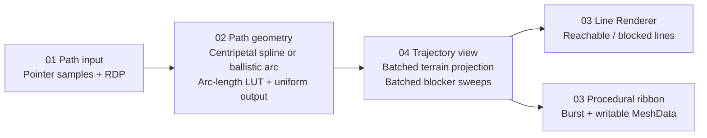
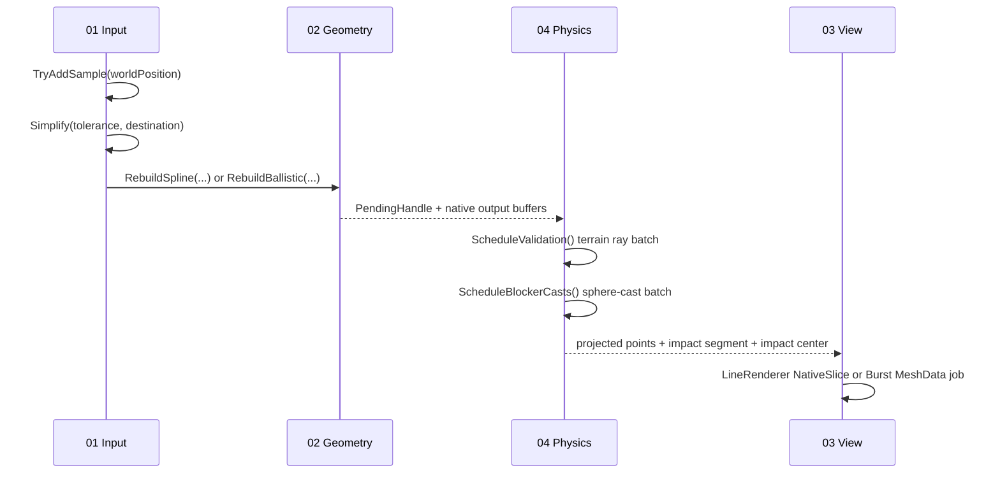

# PathDrawer

**A zero-managed-GC trajectory and spline engine for Unity 6.** PathDrawer turns pointer or touch traces into simplified control paths, uniformly sampled splines or ballistic arcs, terrain-projected trajectories, and a LineRenderer or procedural ribbon mesh.


The default portfolio scene opens with a live trajectory, a terrain-projected reachable ribbon, a blocked continuation, waypoint rings, an impact beacon, and a ballistic preview. Use **LMB drag** to draw, **A/R** to resume the live showcase, **S/B** to select spline or ballistic mode, and **Space** to toggle the arc preview.

The project is split along the four subsystems in the portfolio Engineering X-Ray:



| X-Ray subsystem | Main implementation | Responsibility |
|---|---|---|
| **01 Path input** | [`PathInputDecimator.cs`](Assets/PathDrawer/Runtime/Input/PathInputDecimator.cs) | Preallocated pointer samples, distance/turn hysteresis, iterative RDP simplification |
| **02 Path geometry** | [`CentripetalCatmullRomResampler.cs`](Assets/PathDrawer/Runtime/Geometry/CentripetalCatmullRomResampler.cs) | Burst spline and ballistic lookup generation, arc-length table, uniform-distance output, travel evaluation |
| **03 Line Renderer** | [`PathRenderAdapter.cs`](Assets/PathDrawer/Runtime/Rendering/PathRenderAdapter.cs), [`BurstRibbonMeshBuilder.cs`](Assets/PathDrawer/Runtime/Rendering/BurstRibbonMeshBuilder.cs) | NativeArray LineRenderer submission or Burst ribbon mesh with miter/bevel joins and continuous UVs |
| **04 Trajectory view** | [`TrajectoryPhysicsValidator.cs`](Assets/PathDrawer/Runtime/Validation/TrajectoryPhysicsValidator.cs) | Batched terrain projection, swept blocker queries, first-impact data, reachable-distance evaluation |

The demo composition is [`PathDrawerDemoController.cs`](Assets/Scripts/PathDrawer/Runtime/PathDrawerDemoController.cs). It captures mouse or touch input, schedules geometry and batched physics work without waiting in the frame loop, and updates the LineRenderer and ribbon when the results are ready.

## Runtime flow



### 01 — Path input and RDP

`PathInputDecimator` owns a fixed-capacity `NativeList<float3>`, an integer segment stack, and an RDP keep mask. `TryAddSample` rejects sub-threshold motion and accepts sufficiently sharp turns after a configurable distance fraction. Turn detection has angular hysteresis to avoid threshold chatter. Capacity is fixed: when full, the API rejects a new sample instead of resizing a buffer in the frame loop.

RDP is iterative and non-recursive. It marks endpoints, pops a segment from the preallocated stack, finds the input point with the largest squared distance to that segment, and splits only when the tolerance is exceeded. The output preserves original point order and both endpoints. NativeArray and `ReadOnlySpan<float3>` entry points share the same behavior.

### 02 — Centripetal spline, ballistic arc, and distance sampling

For control points `Pᵢ`, centripetal Catmull–Rom uses knot intervals:

```text
t₀ = 0
tᵢ₊₁ = tᵢ + ||Pᵢ₊₁ - Pᵢ||^α       where α = 0.5
```

Each span is evaluated with the Barry–Goldman interpolation form over these nonuniform knots. Longer point gaps therefore receive longer knot intervals, which reduces the overshoot, loops, and cusps that uniform Catmull–Rom can produce around sharp turns. The API returns the control point exactly at both ends of each span.

The Burst lookup job samples each span into a caller-sized LUT. Its cumulative lengths are:

```text
L₀ = 0
Lᵢ = Lᵢ₋₁ + ||Qᵢ - Qᵢ₋₁||
```

For each output step, a binary search finds the LUT interval containing the requested travel distance. Interpolation supplies an initial point, then a bounded bisection refines the next location until the emitted **Euclidean chord** is `Δs` (default example: `0.20 m`). This gives predictable line spacing for the renderer and movement samples while retaining cumulative source arc length for `EvaluateAtDistance`. The final remainder shorter than `Δs` is omitted; outputs never silently stretch the last interval.

Ballistic mode writes its trajectory into the same LUT format and uses the same binary search, spacing refinement, tangent generation, and travel evaluator. With drag coefficient `k > 0`, it integrates `dv/dt = g - kv` analytically; at `k = 0` it uses `p(t) = p₀ + v₀t + ½gt²`.

All native buffers are allocated by `TrajectoryGeometryBuffer` at construction. `RebuildSpline` or `RebuildBallistic` schedules Burst lookup and resampling jobs and returns their `JobHandle`; complete it before reading the result buffers.

### 03 — Rendering backends

**LineRenderer.** `PathRenderAdapter` reinterprets the native `float3` buffer as `Vector3` and calls Unity's `SetPositions(NativeArray<Vector3>)` overload for the reachable path. A second renderer can show the blocked remainder through a `NativeSlice<Vector3>`. The adapter owns a fixed-capacity display buffer and reserves one extra native slot to insert the exact impact center without per-update array creation.

**Procedural ribbon.** `BurstRibbonMeshBuilder` allocates writable `MeshData`, writes a sequential position/normal/tangent/UV layout and 32-bit indices in a Burst job, then applies the result. The mesh uses incoming and outgoing edge pairs at each path point. Miter joins share a clamped bisector offset; bevel joins keep the two edge offsets and fill the corner wedge. U coordinates follow cumulative path distance divided by `uvMetersPerTile`, so scrolling arrows remain continuous across vertices.

### 04 — Terrain and blocker validation

Physics is deliberately staged because casts need to follow the terrain-projected path:

1. `ScheduleValidation(geometry, count)` schedules vertical `RaycastCommand` projection after the geometry handle. Ballistic mode can disable terrain projection while keeping the blocker sweep.
2. `TryCompleteValidation()` polls the projection handle, adjusts hit samples by `surfaceOffset`, rebuilds projected arc distances/tangents, then schedules one `SpherecastCommand` per segment. It returns without waiting while each batch runs.
3. A later poll records the first blocker and exposes the contact center, surface hit point, segment index, collider, and reachable distance. `CompleteValidation()` remains available for synchronous callers.

Use a terrain-only projection layer mask and a separate obstacle mask. This keeps the swept volume from reporting the terrain directly beneath the path as an obstacle. `EvaluateAtDistance` clamps travel at the first impact; `EvaluateAtNormalizedDistance` maps `[0,1]` onto the reachable distance. The LineRenderer adapter can split the path exactly at `ImpactCenter`.

## Zero managed allocation contract

Steady-state runtime calls use fixed-capacity native buffers and value-type jobs. The managed allocation target is **0 bytes per rebuild/update** after initialization and Burst warmup. This applies to managed GC allocation; Unity's writable mesh-data path still creates/releases native mesh-data storage and uploads GPU buffers when a ribbon is rebuilt. Those native costs are included in the benchmark and should be profiled on the target device.

The guarantee depends on these operating rules:

- Construct each buffer owner once and dispose it at its lifecycle boundary.
- Size capacities for the maximum path, LUT, output, and ribbon vertex counts.
- Complete jobs before reading their outputs, scheduling over the same buffers, or disposing owners.
- Do not allocate managed arrays, closures, LINQ iterators, strings, or temporary components in the caller's per-frame path.
- Warm Burst kernels before measuring steady-state execution.

## Setup and use

Open the repository root (`unity-trajectory-pathdrawer`) in Unity Hub with Unity `6000.6.3f1`; the default project scene is `Assets/Scenes/SampleScene.unity`.

The manifest directly references Burst, Collections, and Mathematics at the versions resolved by this Unity 6 project. The project uses URP 17.6.0. Create two LineRenderers if you want reachable/blocked coloring; the blocked renderer is optional.

```csharp
using PathDrawer.Geometry;
using PathDrawer.Input;
using PathDrawer.Physics;
using PathDrawer.Rendering;
using Unity.Collections;
using Unity.Mathematics;
using UnityEngine;

// Create owners once, with capacities chosen for your product limits.
var input = new PathInputDecimator(capacity: 2048, minimumDistance: 0.04f);
var geometry = new TrajectoryGeometryBuffer(maxLookupSamples: 32769, maxOutputPoints: 4096);
var simplifiedControls = new NativeArray<float3>(2048, Allocator.Persistent);
var mesh = new Mesh { name = "Trajectory Ribbon" };
var physics = new TrajectoryPhysicsValidator(
    maxPoints: 4096,
    projectionLayerMask: terrainMask,
    blockerLayerMask: obstacleMask,
    blockerRadius: 0.15f);
var ribbon = new BurstRibbonMeshBuilder();

// Per gesture: append world samples, then simplify into a preallocated NativeArray<float3>.
input.TryAddSample(worldPoint);
int controlCount = input.Simplify(0.025f, simplifiedControls);

// Per path update: build geometry, project it, and check blockers.
geometry.RebuildSpline(simplifiedControls, controlCount, lookupSamplesPerSegment: 16, outputSpacing: 0.20f);
geometry.Complete();
physics.ScheduleValidation(geometry, geometry.Count);
physics.ScheduleBlockerCasts(); // can be deferred while other work executes
physics.CompleteValidation();
ribbon.Build(mesh, geometry.Positions, physics.PathDistances, geometry.Count, width: 0.3f);

// At the owning component's teardown boundary:
ribbon.Dispose();
physics.Dispose();
geometry.Dispose();
input.Dispose();
simplifiedControls.Dispose();
Object.Destroy(mesh);
```

Treat the owners as long-lived objects and dispose them in reverse order when the path system shuts down. `PathInputDecimator.Samples` and the geometry result properties are native views; they do not transfer ownership.

## Tests and benchmarks

The runtime systems compile in [`PathDrawer.Runtime.asmdef`](Assets/PathDrawer/Runtime/PathDrawer.Runtime.asmdef). NUnit EditMode tests, including the 500-iteration end-to-end allocation probe, live in [`PathDrawerGeometryTests.cs`](Assets/Tests/EditMode/PathDrawerGeometryTests.cs) and the Editor-only [`PathDrawer.EditModeTests.asmdef`](Assets/Tests/EditMode/PathDrawer.EditModeTests.asmdef).

Run **Window → General → Test Runner → EditMode → Run All**. Coverage includes:

- RDP reduction and endpoint preservation.
- Exact Catmull–Rom control interpolation and no cusp/reversal around acute turns.
- `<1e-3 m` Euclidean output spacing on highly uneven controls at a `0.20 m` step.
- `GC.GetAllocatedBytesForCurrentThread()` across 1,000 warmed geometry rebuilds.
- `GC.GetAllocatedBytesForCurrentThread()` across 500 warmed input + geometry + writable-MeshData ribbon frame-loop iterations.

The demo scene, benchmark, and screenshot capture have dedicated Editor GUI commands under **Tools → PathDrawer**:

1. **1. Build & Save Ready-to-Play SampleScene** creates and wires the tactical floor, plateau and ramps, obstacle monoliths and physics layer, perspective camera, URP post-processing, line and ribbon renderers, waypoint/impact markers, controller, and telemetry HUD in `Assets/Scenes/SampleScene.unity`.
2. **2. Run Benchmark Sweep & Export Markdown** warms Burst, runs 30 measured samples for 100, 500, and 2,000 points, writes `PathDrawer-Benchmark-Results.md`, and replaces the README table with the measured median and P95 values from that machine.
3. **3. Capture 1080p Portfolio Screenshot** enters Play Mode if needed, waits for 60 live frames, and renders `docs/screenshots/pathdrawer-game-view.png` at 1920×1080.

Latest GUI verification: Unity **6000.6.3f1**, **7/7 EditMode tests passed**, including the 500-iteration end-to-end allocation test, and the 1080p live capture is checked in above. The benchmark table and [raw Markdown report](PathDrawer-Benchmark-Results.md) were generated by the Editor menu on the listed processor. The Polish [implementation audit](IMPLEMENTATION_AUDIT_PL.md) records the verification scope and the remaining editor/input limitations.

| Input points | RDP points | Output points | RDP median (µs) | Spline + LUT median (µs) | Ribbon median (µs) | Total median (µs) | Total P95 (µs) |
|---:|---:|---:|---:|---:|---:|---:|---:|
| 100 | 10 | 110 | 115.3 | 115.7 | 29.0 | 256.8 | 276.5 |
| 500 | 42 | 552 | 1022.7 | 628.1 | 119.1 | 1854.0 | 2186.9 |
| 2000 | 172 | 2211 | 5203.6 | 2402.1 | 251.9 | 7802.9 | 9430.1 |

## Capacity and profiling notes

- A spline with `N` controls and `S` lookup samples per segment requires at least `(N - 1) × S + 1` lookup entries.
- The ribbon emits `5 × pointCount` vertices and `6 × (pointCount - 1) + 6 × max(0, pointCount - 2)` indices.
- `PathRenderAdapter` reserves one extra native display slot for exact impact insertion; its constructor argument remains the maximum trajectory point count.
- Physics query arrays are fixed at construction. Over-capacity inputs fail at the API boundary rather than resize on a hot path.
- Profile Mono GC allocation, job waits, MeshData allocation/application, and GPU upload separately; a zero managed allocation result does not imply zero native or GPU work.

## GitHub Actions

The `Unity EditMode Tests` workflow runs the EditMode suite with Unity `6000.6.3f1` using GameCI. Add the activated Unity Personal license file as a repository Actions secret named `UNITY_LICENSE` before the workflow can run. GitHub supplies the workflow token automatically. Local GUI test runs do not require this CI secret.

## License

PathDrawer is released under the MIT License; see [LICENSE](LICENSE).
