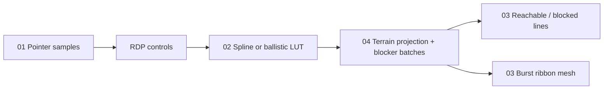

# PathDrawer

[](LICENSE)

**A Unity 6 path input, spline, and trajectory engine.** Convert a pointer trace into a simplified path, distance-spaced spline or ballistic arc, terrain projection, blocker result, and a Burst-generated ribbon. Runtime buffers are preallocated; the warmed geometry and full frame-loop EditMode probes report **0 B managed GC**.


Unity **6000.6.3f1** · URP 17.6 · Burst · Collections · Mathematics · Input System 1.18

## Engineering X-Ray

| Subsystem | Implementation | What it does |
|---|---|---|
| **01 Path input** | `PathInputDecimator` | Fixed-capacity pointer samples, distance/turn hysteresis, iterative stack-based RDP. |
| **02 Path geometry** | `CentripetalCatmullRomResampler` | α = 0.5 Catmull–Rom, cumulative arc-length LUT, binary-search distance sampling, ballistic integration. |
| **03 Line Renderer** | `PathRenderAdapter`, `BurstRibbonMeshBuilder` | NativeArray LineRenderer submission and writable MeshData ribbon with miter/bevel joins and continuous UVs. |
| **04 Trajectory view** | `TrajectoryPhysicsValidator` | Batched terrain raycasts, blocker sphere casts, first-impact split, distance-based travel evaluation. |



## Performance

Editor benchmark: Unity 6000.6.3f1 on an Intel Core i3-13100F, 30 measured samples after Burst warmup. Times include input simplification, spline/LUT work, and writable ribbon generation.

| Input points | RDP points | Output points | RDP median (µs) | Spline + LUT median (µs) | Ribbon median (µs) | Total median (µs) | Total P95 (µs) |
|---:|---:|---:|---:|---:|---:|---:|---:|
| 100 | 10 | 110 | 115.3 | 115.7 | 29.0 | **256.8** | 276.5 |
| 500 | 42 | 552 | 1022.7 | 628.1 | 119.1 | 1854.0 | 2186.9 |
| 2000 | 172 | 2211 | 5203.6 | 2402.1 | 251.9 | 7802.9 | 9430.1 |

These are measurements from the checked-in Editor benchmark report, not a cross-device guarantee. The EditMode suite includes warmed 1,000-rebuild geometry and 500-iteration full-pipeline zero-managed-allocation checks. MeshData allocation and GPU upload still consume native memory and time.

## Sampling model

Centripetal Catmull–Rom sets knot intervals using `Δt = ||Pᵢ₊₁ − Pᵢ||^0.5`. Nonuniform intervals reduce overshoot around tight turns. A preallocated lookup stores cumulative segment length; a binary search locates each requested travel distance, then bounded refinement keeps the emitted Euclidean step within the configured spacing. The same LUT and uniform-distance resampler serve ballistic trajectories.

The demo uses **0.20 m** spline spacing, a continuous 80×80 terrain mesh, and synchronous capture rebuilds. Input gestures use batched terrain and obstacle queries; the showcase builds and validates deterministically before updating the view.

## Run it

Open the repository in Unity **6000.6.3f1**. The checked-in `Assets/Scenes/SampleScene.unity` is the runnable sample. Use the HUD buttons or keyboard: **LMB** draw, **S** spline, **B** ballistic, **Space** arc preview, **R** restore Auto-Showcase.

The runtime owners are constructed once and disposed with their controller:

```csharp
input.TryAddSample(worldPosition);
int controls = input.Simplify(tolerance, simplifiedControls);
geometry.RebuildSpline(simplifiedControls, controls, 16, 0.20f).Complete();
physics.ScheduleValidation(geometry, geometry.Count);
physics.ScheduleBlockerCasts();
physics.CompleteValidation();
ribbon.Build(mesh, geometry.Positions, physics.PathDistances, geometry.Count, width: 0.42f);
```

Run **Window → General → Test Runner → EditMode → Run All**. The Unity Editor menu **Tools → PathDrawer** rebuilds the sample scene, exports fresh benchmark metrics, captures the 1080p showcase, and builds a WebGL ZIP for itch.io. Install the matching WebGL Build Support module in Unity Hub before using menu item 4.

| Editor command | Output |
|---|---|
| **1. Build & Save Ready-to-Play SampleScene** | `Assets/Scenes/SampleScene.unity` and generated terrain/material assets. |
| **2. Run Benchmark Sweep & Export Markdown** | `PathDrawer-Benchmark-Results.md` plus updated README metrics. |
| **3. Capture 1080p Portfolio Screenshot** | `docs/screenshots/pathdrawer-game-view.png`, with content assertions before saving. |
| **4. Build WebGL for itch.io (ZIP)** | `Builds/WebGL-ItchIo/` and a ZIP whose root contains `index.html`. |

## Copyright and reuse

The original C# runtime, editor, and test source listed in [LICENSE](LICENSE) is available under the MIT License. This grant covers code only; the sample scene, generated project assets, screenshots, documentation, Unity materials, and third-party packages remain under separate terms. See [COPYRIGHT.md](COPYRIGHT.md) and the notices included with third-party components.
